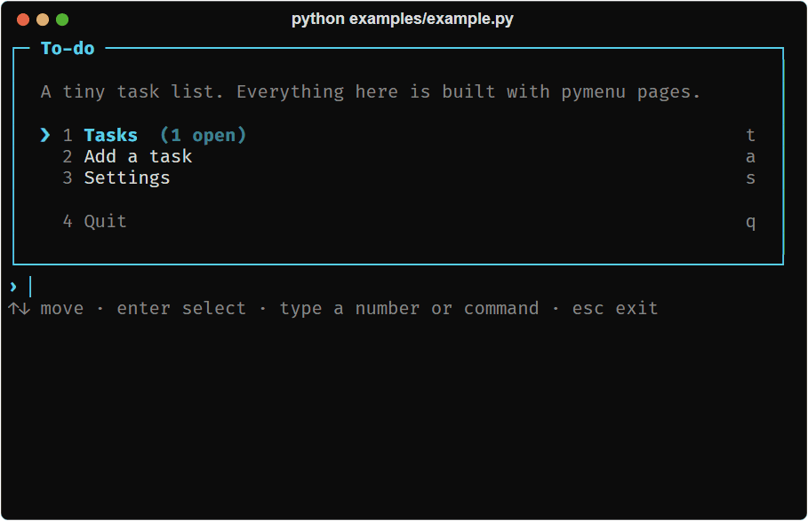

<div align="center">

# 📋 pymenu

**Console menus made of pages, with arrow keys, numbers and commands.**

Describe every screen as a small class, return the items it shows, and pymenu
draws it with [rich](https://github.com/Textualize/rich), handles the keyboard
and keeps the history so you can go back.

[](https://github.com/mredwardlik/pymenu/actions/workflows/tests.yml)




</div>

---

## ✨ Features

- 📄 **Pages as classes**: `build()` returns the items, and it runs before
  every render, so labels always show the current state
- ⌨️ **Three ways to choose**: arrows + Enter, the item number, or a command
  word (`a`, `help`...). Single keys work at once, words wait for Enter
- 🧭 **Navigation**: `Redirect` to another page, `Back` or Esc to return,
  breadcrumbs in the frame, the cursor position is remembered per page
- 🕵️ **Hidden commands** that aren't in the list, and plain `Text` lines for
  headings and hints
- 💬 **Messages**: whatever an action prints appears under the menu, and an
  exception in an action is shown instead of crashing the app
- 🧪 **Works without a terminal**: when the input is piped, pymenu switches to
  line-by-line mode, so menus can be scripted and tested

## 🚀 Installation

```bash
pip install git+https://github.com/mredwardlik/pymenu.git
```

Python 3.9 or newer. The only dependency is `rich`.

## 🧑‍💻 Quick start

```python
from pymenu import Back, Exit, Item, Page, PyMenu, Redirect, Text

menu = PyMenu()


@menu.page('home')
class Home(Page):
    title = 'My app'
    description = 'Choose with the arrows, a number or a command.'

    def build(self):
        return (
            Item('Say hello', action=self.hello, triggers='h'),
            Redirect('settings', 'Settings', triggers='s'),
            Text(),
            Exit('Quit', triggers='q'),
        )

    def hello(self):
        name = self.input('Your name: ')
        self.print(f'Hello, [bold]{name}[/bold]!', style='green')


@menu.page('settings')
class Settings(Page):
    title = 'Settings'

    def build(self):
        dark = self.context.data.get('dark', True)
        return (
            Item(f'Dark theme: {"on" if dark else "off"}', action=self.toggle),
            Back(),
        )

    def toggle(self):
        self.context.data['dark'] = not self.context.data.get('dark', True)


menu.run('home')
```

A bigger example, a small to-do app from the animation above, is in
[`examples/example.py`](examples/example.py):

```bash
python examples/example.py
```

## 🧱 Elements

| Element                                  | What it does                                                    |
| ---------------------------------------- | --------------------------------------------------------------- |
| `Item(label, action, triggers)`          | runs `action()` when chosen                                     |
| `Redirect(to, label, triggers)`          | opens the page `to`                                             |
| `Back(label='Back', triggers)`           | returns to the previous page (closes the menu on the first one) |
| `Exit(label='Exit', triggers)`           | closes the menu                                                 |
| `Hidden(action, triggers)`               | not shown; works only through its triggers                      |
| `Text(text='', style)`                   | a line that can't be chosen: heading, hint, empty line          |
| `Group(*elements)`                       | several elements as one (a tuple or a list works too)           |

`triggers` is a string or a list of strings. They don't depend on case.
Labels and messages support [rich markup](https://rich.readthedocs.io/en/stable/markup.html):
`'[green]on[/green]'`.

## ⌨️ Keys

| Key                     | Action                                                  |
| ----------------------- | ------------------------------------------------------- |
| `↑` `↓` `Home` `End`    | move the cursor                                         |
| `Enter`                 | choose the item under the cursor, or the typed command  |
| `1`...`9`, a letter     | choose at once if nothing longer starts with it         |
| a word + `Enter`        | run a command, for example `history`                    |
| `Backspace`             | edit the typed command                                  |
| `Esc`                   | clear the command, or go back                           |
| `Ctrl+C`                | close the menu                                          |

## 📄 Pages

```python
@menu.page            # name = class name
@menu.page()          # same
@menu.page('home')    # custom name
class Home(Page):
    title = 'Home'                  # frame title, class name by default
    description = 'Optional text'   # shown under the title

    def build(self):                # called before every render
        ...
```

Inside a page:

| Member                       | Description                                                   |
| ---------------------------- | ------------------------------------------------------------- |
| `self.print(*text, style=)`  | show a message under the menu                                 |
| `self.input(prompt)`         | ask for a line of text                                        |
| `self.go(name)`              | open another page                                             |
| `self.back()`, `self.exit()` | go back, close the menu                                       |
| `self.context.data`          | a `dict` shared by all pages: settings, the logged-in user... |
| `self.context.history`       | names of the opened pages, the current one is last            |

And on the menu:

```python
@menu.none                      # called when a missing page is opened
def missing(pagename):
    menu.message(f'Page "{pagename}" is not ready yet.', style='yellow')

context = menu.run('home')      # blocks until the user leaves, returns the context
menu.pages                      # (('home', Home), ('settings', Settings))
```

## 🤖 Scripts and tests

When the input is not a terminal, pymenu reads commands line by line, so you
can drive a menu from a script:

```bash
printf '2\nBuy bread\nq\n' | python examples/example.py
```

In tests, pass a terminal with scripted keys:

```python
from pymenu import InteractiveConsole, PyMenu
from pymenu.keys import DOWN, ENTER

keys = [DOWN, ENTER, 'q']
menu = PyMenu(InteractiveConsole(read_key=lambda: keys.pop(0), clear=False))
```

## 🗂 Project structure

```text
pymenu/
├── pymenu/
│   ├── main.py       # PyMenu: registration, navigation, the main loop
│   ├── page.py       # Page base class
│   ├── elements.py   # Item, Redirect, Back, Exit, Hidden, Text, Group
│   ├── console.py    # InteractiveConsole (keys) and LineConsole (lines), drawing
│   ├── keys.py       # single key presses on Windows and POSIX terminals
│   ├── triggers.py   # trigger matching
│   ├── context.py    # history and shared data
│   └── holder.py     # page registry
├── examples/example.py
└── tests/
```

## 🧪 Tests

```bash
pip install -e ".[dev]"
pytest
```

The tests drive menus with scripted keys and piped lines, and check key
decoding for Windows and for POSIX terminals (through a pseudo-terminal). CI
runs them on Linux, Windows and macOS.

## 📄 License

[MIT](LICENSE)
